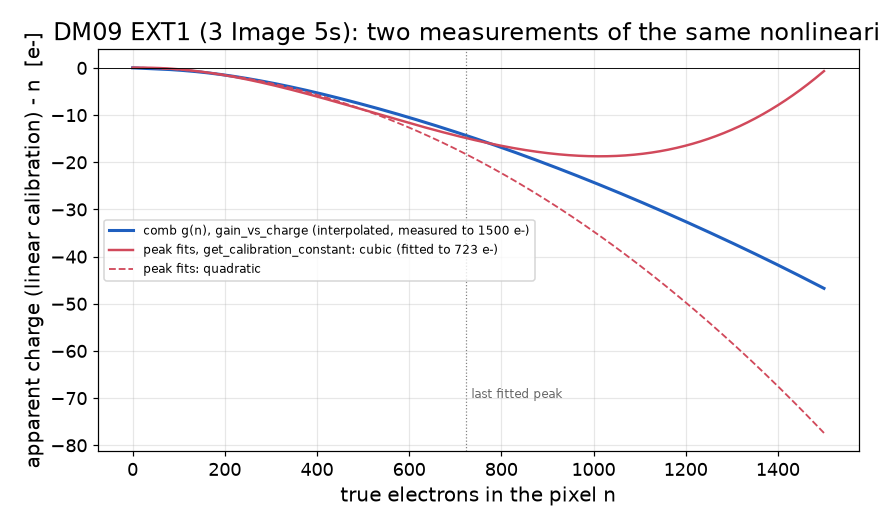

# g(n) correction and the new polynomial gain calibration in WADERs (2026-11-02)

On 2026-11-02 two commits went into pysimdamicm `waders_LBC` (N. Castello-Mor):

- **34d20ea** "Adapt scripts to estimate gain (linear, quadratic and cubic models), and adapt Calibration
  process accordingly"
- **70003b6** "Add also cubic correction for the gain"

What they do:

- `bin/get_calibration_constant` fits the position of every single-electron peak and fits
  `mu(n) = p0 + p1 n + p2 n^2 (+ p3 n^3)` to those positions.
- `CalibrationProcess` accepts `gain: [g, c2, c3]`, `offset` and `valid_range`. It inverts
  `ADU = offset + g e + c2 e^2 + c3 e^3` for the whole image. Outside `valid_range` it continues the
  curve linearly.

This is the same physics as comm_scripts' g(n) (`gain_vs_charge` → `GainNonlinearityProcess`): both
describe A(n), the ADU of a pixel with n electrons.

## Merge

`git subtree pull` of `waders_LBC` @ 70003b6 into `WADERs/` applied without conflicts. Our additions are
in files and functions the two commits do not touch. The local fixes are kept: `np.longdouble`, TH1
`SetDirectory(0)` and `FitDarkCurrentProcess.x_max_plot`.

## The interaction, and the change made

`GainNonlinearityProcess` (WADERs clusters) and the A_GMX path used to rebuild a pixel's ADU as
`e x GAIN_<amp>`. That is exact only for a linear calibration. With a polynomial calibration, the g(n)
correction would have been applied on top of an already non-linear conversion.

Now `gain_nonlinearity.calibration_adu(e, amp)` rebuilds the ADU with `CalibrationProcess`'s own curve:

- it reads the coefficients `CAL<amp>k`, the offset `CAL<amp>0` and the range `CAL<amp>R0/R1`, which
  `CalibrationProcess` records in the header;
- it includes the same linear continuation outside the range;
- ADU is counted from the zero-electron peak (the offset), as in g(n).

So with `GainNonlinearityProcess` active, g(n) *replaces* the polynomial for the cluster energies; it is
never applied twice. The log says so for each amplifier.

Tests:

- **Unit test:** `calibration_adu(CalibrationProcess._adu_to_e(adu))` equals `adu - offset` to 5e-13 ADU,
  inside and outside the valid range.
- **panaSKImg, DM09 Image 5 (image 1, EXT1), polynomial calibration + g(n) against linear calibration +
  g(n):**
  - energies equal to 2e-5 (median), largest pixel difference 2e-5 keV;
  - 909 of 921 clusters identical. The threshold cut runs on the polynomial-calibrated image, so a few
    cluster boundaries move.

## The two measurements compared (DM09 EXT1, the three Image 5s pooled)

`get_calibration_constant` on the calibrated images (`--unit e -k 1`) fitted 629 peaks up to n = 723 and
preferred the cubic. Apparent charge with a linear calibration minus the true charge:

| n [e-] | comb g(n) | peak-fit cubic | peak-fit quadratic |
|---|---|---|---|
| 100 | -0.5 | -0.3 | -0.4 |
| 300 | -3.2 | -3.6 | -3.3 |
| 500 | -7.8 | -8.9 | -8.9 |
| 723 | -14.3 | -14.9 | -18.3 |
| 1000 | -24.3 | (-18.7, beyond its range) | (-34.7) |
| 1500 | -46.8 | (-0.7) | (-77.4) |

- **Up to the last fitted peak** the two agree to about 1 e-.
- **Beyond it** the raw cubic turns back up. `CalibrationProcess` avoids this only if `valid_range` is set,
  and then continues linearly with the slope at the edge. The comb measurement continues to 1500 e- on
  this CCD (to 2000-7000 e- elsewhere).

Fe-55 energies, same image and CCD:

- **Her polynomial alone against g(n):** Kα 0.71 % lower (340 clusters), Kβ 0.67 % lower, clusters above
  10 keV 0.76 % lower.
- **Where the 0.71 % comes from:**
  - 0.23 % is the energy per electron: WADERs' fixed 3.74 eV against epsilon(T) = 3.7486 eV at 130 K;
  - most of the rest is the low-charge gain. Her curve is anchored at the image's own 0e-/1e- gain
    (1.3409); g(n) with `anchor: comb` uses the module's comb gain (1.3341), the choice that aligned
    Kα across 11 CCDs in the DM24-26 test.
- **Pixel range:** the Kα clusters have a brightest pixel of 898 e- (median), 1509 e- (90th percentile).
  Half of them reach beyond a 723 e- valid range.

## Points to discuss with Nuria

1. **One correction, not two.** If both are configured, which one defines the cluster energies? Here: g(n)
   when GainNonlinearityProcess runs, the polynomial otherwise. Agree on this, or merge the two (for
   example GainNonlinearityProcess writing its curve as the calibration).
2. **Range.**
   - The peak fits reach 723 e- on these three images (pooled); the comb reaches 1500-7000 e-.
   - keV clusters have pixels at 900-5000 e-.
   - A combined approach: peak fits at low n (more precise there), comb above.
3. **`valid_range`** is described as "written by get_calibration_constant", but its JSON has `fit_range`
   only. Without it, the cubic is inverted over the whole axis and fails beyond its turning point
   (about 1000 e- here).
4. **`CalibrationProcess` is defined twice** in skipper_analysis.py (a stub at line 1248, then the full
   class). Harmless, since the second definition wins, but probably unintended.
5. **e2eV**: WADERs' fixed 3.74 eV against epsilon(T) (3.7486 eV at 130 K); 0.23 % on every energy.

## Which is better for energies? Fe-55 Kα on all 12 CCD-images (DM09 Image 5 × 3, EXT1-4)

Method:

- Her preferred model per CCD (`get_calibration_constant` on the 3 calibrated images pooled) was written into
  `CalibrationProcess` of each image: scaled by the image's own calibration gain, with `valid_range` = the
  fitted range.
- panaSKImg was run per CCD, without g(n).
- Front-side Kα (σ_xy < 1, the unbinned Kα + Kβ fit of run_WADERs) was fitted per file. True value 5.895 keV.

| | mean (excl. EXT2) | rms over the 9 CCD-images | EXT2 (gain rises at low charge) |
|---|---|---|---|
| no correction (linear gain) | 5.766 keV (−2.2 %) | 42 eV | ~6.4 keV (+9 %) |
| peak-fit polynomial (her method) | 5.875 keV at 3.74 eV/e-, 5.888 at 3.7486 (−0.1 %) | 42 eV | ~4.75 keV (−20 %): the fit failed (offset −1.13 e-, slope 1.098: peaks numbered off by one) |
| comb g(n), anchor comb | 5.891 keV (−0.07 %) | 13 eV | 5.82-5.89 keV |

- **Mean energy:** where her fit works, it is about as good as g(n), once both use the same eV per electron.
- **Spread:** g(n) is three times tighter across CCDs and images. Its low-charge gain comes from the comb of
  all images of the module, while her polynomial follows each image's own fitted gain. Image 0 (gain held at
  a poorer fit) has the largest offsets.
- **Robustness:** the comb measurement works on all four CCDs; the automatic peak fit failed on EXT2.

Caveats:

- One module and three images only.
- Her tool was run on the calibrated images pooled, with its polynomial scaled by each image's gain. A fit
  per image in ADU, as intended, could do better on the spread, but not on EXT2's failure or on the range
  above about 700-840 e-.
